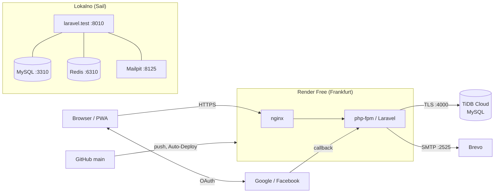
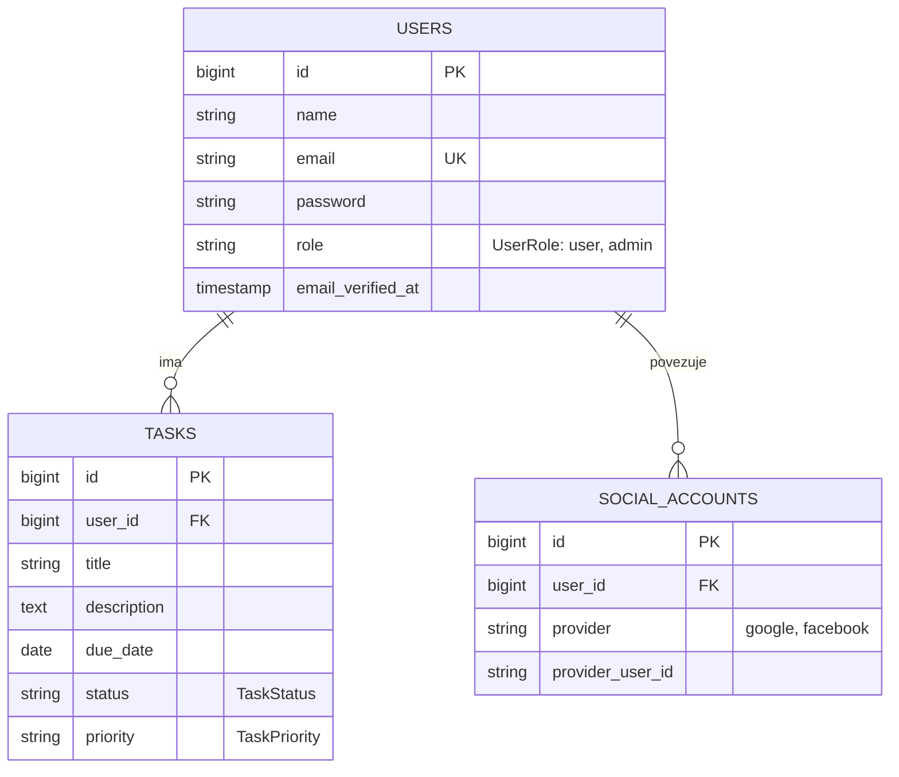
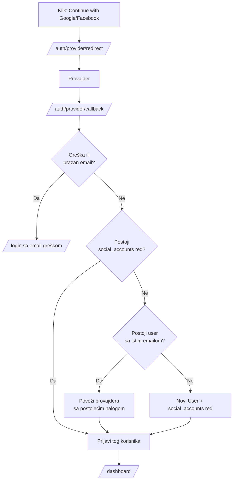
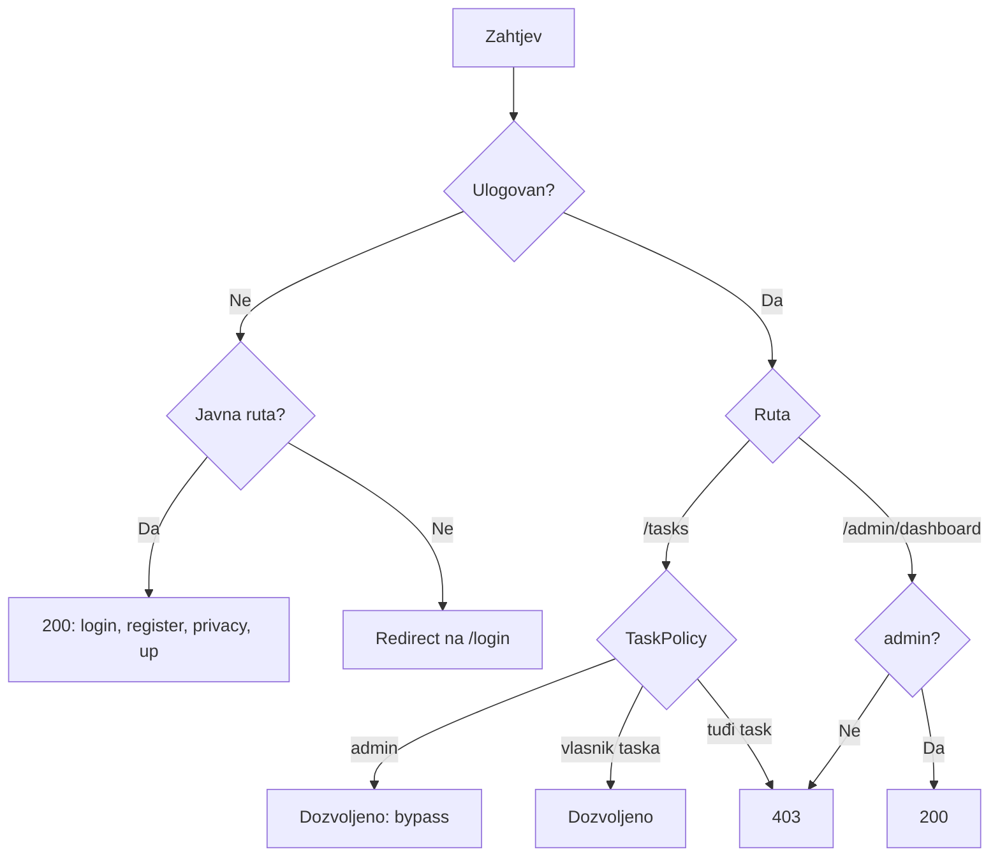

# Taskly

Taskly je ToDo aplikacija izrađena u Laravelu, kao projekat za učenje. Podržava više tipova korisnika, admin dashboard, CRUD nad zadacima i prijavu preko Googlea i Facebooka. Interfejs je dvojezičan (EN/SR), a aplikacija radi i kao PWA.

**Live:** https://taskly-olux.onrender.com (Render Free: servis se uspava nakon ~15 min neaktivnosti, pa prvi zahtjev traje ~50 s)

## Funkcionalnosti

- Registracija, prijava, reset lozinke i profil (Laravel Breeze)
- Prijava preko Googlea i Facebooka (Socialite); nalog se povezuje po emailu
- CRUD nad zadacima: naslov, opis, rok, status i prioritet; svaki korisnik vidi samo svoje zadatke
- Uloge `user` i `admin`; admin na `/admin/dashboard` vidi statistike i sve korisnike i zadatke
- Dvojezičan interfejs (EN/SR) sa prebacivanjem jezika
- Tamna tema sa sidebar navigacijom, prilagođena mobilnom prikazu
- PWA: manifest, service worker i offline stranica
- Stranica `/tutorial` sa GIF snimcima svih funkcionalnosti
- Javna stranica `/privacy`

## Tehnologije

Laravel 13, PHP 8.5, MySQL, Blade, Tailwind CSS v4, Alpine.js, Vite, PHPUnit. Lokalni razvoj ide kroz Laravel Sail (Docker). Produkcija je na Renderu (Docker) sa TiDB Cloud bazom.

## Lokalno pokretanje

Potrebni su Docker i Composer.

```bash
cp .env.example .env
composer install
vendor/bin/sail up -d
vendor/bin/sail artisan key:generate
vendor/bin/sail artisan migrate --seed
vendor/bin/sail npm install
vendor/bin/sail npm run dev
```

Zadani portovi u `.env.example` mogu biti zauzeti. U razvoju su korišćeni `APP_PORT=8010`, `FORWARD_DB_PORT=3310`, `FORWARD_REDIS_PORT=6310`, `FORWARD_MAILPIT_PORT=1125` i `FORWARD_MAILPIT_DASHBOARD_PORT=8125`.

| Servis | Adresa |
| --- | --- |
| Aplikacija | http://localhost:8010 |
| Mailpit (test mejlovi) | http://localhost:8125 |
| Vite dev server | http://localhost:5173 |

### Test nalozi (seed)

| Email | Lozinka | Uloga |
| --- | --- | --- |
| `test@example.com` | `password` | user |
| `admin@example.com` | `password` | admin |

Ovi nalozi služe samo za lokalni razvoj.

### Social login

Za Google i Facebook prijavu popuni `GOOGLE_CLIENT_ID`, `GOOGLE_CLIENT_SECRET`, `FACEBOOK_CLIENT_ID` i `FACEBOOK_CLIENT_SECRET` u `.env`. Callback adrese su `/auth/google/callback` i `/auth/facebook/callback`, a moraju se poklapati sa onima podešenim kod provajdera.

## Testovi i formatiranje

```bash
vendor/bin/sail artisan test --compact
vendor/bin/sail bin pint --format agent
```

## Struktura

- `app/Http/Controllers`: `TaskController`, `Admin/DashboardController`, `Auth/SocialLoginController`
- `app/Policies/TaskPolicy.php`: autorizacija zadataka (admin ima pristup svemu)
- `app/TaskStatus.php`, `app/TaskPriority.php`, `app/UserRole.php`: enumi sa `label()` metodama za prevod
- `lang/`: prevodi (`sr.json` i `lang/sr/*.php`)
- `resources/views`: Blade prikazi i komponente
- `public/sw.js`, `public/manifest.webmanifest`, `public/offline.html`: PWA
- `Dockerfile`, `deploy/`, `render.yaml`: produkcioni deploy na Render

## Docker

Projekat koristi dvije odvojene Docker konfiguracije: Sail za razvoj i produkcioni `Dockerfile` za Render.

### Razvoj: Laravel Sail (`compose.yaml`)

Servisi na zajedničkoj `sail` bridge mreži:

| Servis | Slika | Port (host) |
| --- | --- | --- |
| `laravel.test` | build iz `vendor/laravel/sail/runtimes/8.5` (PHP 8.5) | `APP_PORT` (8010), `VITE_PORT` (5173) |
| `mysql` | `mysql:8.4` | `FORWARD_DB_PORT` (3310) |
| `redis` | `redis:alpine` | `FORWARD_REDIS_PORT` (6310) |
| `mailpit` | `axllent/mailpit` | SMTP `FORWARD_MAILPIT_PORT` (1125), UI `FORWARD_MAILPIT_DASHBOARD_PORT` (8125) |

- Kod se mountuje u kontejner (`.:/var/www/html`), pa se izmjene vide odmah.
- MySQL i Redis podaci su u imenovanim volumenima `sail-mysql` i `sail-redis`.
- `laravel.test` čeka `mysql`, `redis` i `mailpit` (`depends_on`).
- Sve komande idu kroz `vendor/bin/sail ...`. Node 24 postoji unutar kontejnera, pa nije potreban lokalno.
- Portovi se mijenjaju u `.env`, jer su zadani često zauzeti drugim projektima.

### Produkcija: `Dockerfile` (multi-stage)

Jedan kontejner sa nginx-om i php-fpm-om, koji pokreće supervisor.

1. **`vendor`** (`composer:2`): `composer install --no-dev`, bez skripti i autoloadera.
2. **`assets`** (`node:24-alpine`): `npm ci` i `npm run build` (Vite, Tailwind v4). Kopira se i `app/`, jer Tailwind iz klasa u PHP-u gradi CSS, kao i Laravel pagination views iz `vendor`.
3. **`app`** (`php:8.5-fpm-alpine`): ekstenzije `pdo_mysql`, `intl` i `zip` (preko `mlocati/php-extension-installer`), paketi `nginx`, `supervisor` i `ca-certificates`. Preuzima `vendor` iz prve faze i `public/build` iz druge. Zatim radi `composer dump-autoload --optimize` i `package:discover`, pravi `storage` i `bootstrap/cache` direktorijume i daje vlasništvo korisniku `www-data`.

Konfiguracija u `deploy/`:

| Fajl | Namjena |
| --- | --- |
| `nginx.conf` | Šablon sa `__PORT__`; root je `public/`, PHP ide na php-fpm `127.0.0.1:9000`, `manifest.webmanifest` se servira kao `application/manifest+json`, a skriveni fajlovi su zabranjeni |
| `supervisord.conf` | Pokreće `php-fpm -F` i `nginx` (u foreground-u, sa `autorestart`); logovi idu na stdout/stderr |
| `php.ini` | Opcache postavke |
| `php-fpm.conf` | `clear_env = no` (da PHP vidi Render env varijable) i `catch_workers_output` |
| `start.sh` | Ulazna tačka kontejnera |

`start.sh` pri svakom startu, redom:

1. prekida rad ako `APP_KEY` nije postavljen;
2. u `nginx.conf` upisuje port iz `$PORT` (zadano 10000) i smješta ga u `/etc/nginx/http.d/`;
3. pokreće `php artisan migrate --force`;
4. opciono pokreće demo seed (`DEMO_SEED_EMAILS=a@example.com,b@example.com`; preskače korisnike koji već imaju zadatke, a greška ne zaustavlja start);
5. keširanje: `config:cache`, `route:cache`, `view:cache`;
6. `exec supervisord`.

`.dockerignore` isključuje `.env*` (osim `.env.production.example`), `vendor`, `node_modules`, `tests`, `public/build`, `public/hot`, `bootstrap/cache/*.php` i logove. Na taj način razvojni provajderi i secreti ne ulaze u image.

Lokalna provjera produkcionog image-a:

```bash
docker build -t taskly .
docker run --rm -p 10000:10000 --env-file .env -e APP_KEY=... taskly
```

Kontejner treba da dosegne bazu iz `.env`.

## GitHub

- Repozitorijum: https://github.com/laraveltest1912974/taskly (javan), nalog `laraveltest1912974`.
- Remote `origin` je `https://github.com/laraveltest1912974/taskly.git`, a lokalna grana `main` prati `origin/main`.
- Autentikacija je preko GitHub CLI-ja (`gh`), HTTPS protokol, sa scope-ovima `repo`, `workflow`, `read:org` i `gist`. Git koristi token koji je `gh` podesio, pa nisu potrebni SSH ključevi.

### Prvo povezivanje

```bash
git init -b main
git add . && git commit -m "Initial commit"
gh auth login                      # HTTPS + browser (device code na https://github.com/login/device)
gh repo create taskly --public --source=. --remote=origin --push
```

Prije prvog commita provjeri da `.env`, `vendor/`, `node_modules/` i `.idea/` nisu uključeni. Starter kit ih već ima u `.gitignore`.

### Instalacija `gh` u WSL-u

Ako `sudo` nije dostupan, `gh` se može instalirati kroz root pristup sa Windows strane:

```powershell
wsl.exe -d Ubuntu -u root -- <komanda>
```

Ako instalacija pukne zbog ranije prekinutog `apt`-a, prvo pokreni `dpkg --configure -a`. WSL ne može da otvori browser (`xdg-open` ne postoji), pa se device kod prijave unosi ručno na https://github.com/login/device.

### Veza sa Renderom

- Render **nije** povezan preko GitHub aplikacije. Servis je napravljen kao Blueprint iz javnog repoa (*New → Blueprint → Public Git Repository*).
- Svaki push na `main` ipak sam pokreće deploy (*Auto-Deploy*, oko 50 s), pa `Manual Deploy` nije potreban.
- Zato je za objavu dovoljno `git push`. Izmjene u `render.yaml` Render sinhronizuje, ali nove `sync: false` varijable nekad treba ručno dodati u Environment tab.
- GitHub Actions se trenutno ne koriste. Token ima `workflow` scope, pa se mogu dodati kasnije (npr. za testove pri svakom pushu).

## Deploy (Render + TiDB Cloud)

Render preko `render.yaml` (Blueprint) gradi Docker image iz `Dockerfile` i sam pokreće deploy pri svakom pushu na `main`. Pri startu `deploy/start.sh` pokreće migracije i keširanje konfiguracije. Secreti (`APP_KEY`, podaci za bazu, OAuth i SMTP kredencijali) upisuju se ručno u Render dashboard i ne ulaze u repo.

Napomene za Render Free:
- Baza je spoljna (TiDB Cloud, port 4000, obavezan TLS preko `MYSQL_ATTR_SSL_CA`).
- Nema queue workera ni crona, pa je `QUEUE_CONNECTION=sync`, a sesije i keš su u bazi.
- Mejlovi idu preko Brevo SMTP na portu 2525, jer su 587, 465 i 25 blokirani.
- `APP_URL` mora biti `https://...`, a `trustProxies` je podešen u `bootstrap/app.php`.

## Spoljni servisi

| Servis | Čemu služi | Konzola |
| --- | --- | --- |
| **Google Auth Platform** (Google Cloud, projekat `taskly-509018`) | Prijava preko Googlea (OAuth 2.0) | https://console.cloud.google.com/auth/overview?project=taskly-509018 |
| **Meta for Developers** (aplikacija *Taskly*) | Prijava preko Facebooka (Facebook Login) | https://developers.facebook.com/apps/ |
| **Brevo** (SMTP) | Slanje mejlova (reset lozinke) | https://app.brevo.com |
| **Render** | Hosting aplikacije (Docker, Free plan) | https://dashboard.render.com/ |
| **TiDB Cloud** (Starter) | MySQL-kompatibilna baza u produkciji | https://tidbcloud.com/ |
| **GitHub** | Repozitorijum i okidač za Auto-Deploy | https://github.com/laraveltest1912974/taskly |
| **Bunny Fonts** | Font Inter (bez praćenja korisnika) | https://fonts.bunny.net |

### Google prijava

- OAuth klijent *Taskly local* (Web application) ima dva redirect URI-ja: `http://localhost:8010/auth/google/callback` i `https://taskly-olux.onrender.com/auth/google/callback`. Moraju se poklapati tačno, uključujući port.
- Consent screen je u režimu **Testing**, pa se mogu prijaviti samo dodati test korisnici (najviše 100). Inače Google vraća `access_denied`.
- Za javnu upotrebu aplikaciju treba prebaciti u *In production*.
- Google Cloud konzola zahtijeva uključen 2-Step Verification na nalogu.
- Client secret se prikazuje samo pri kreiranju; ako se izgubi, dodaje se novi u *Clients*.

### Facebook prijava

- Use case je *Authenticate and request data from users with Facebook Login*, sa dozvolama `public_profile` i `email`. Dozvola `email` je obavezna, jer `SocialLoginController` odbija prijavu bez emaila.
- U **Development** režimu mogu se prijaviti samo nalozi sa ulogom u aplikaciji (Admin, Developer, Tester). Nalog bez emaila (samo telefon) ne može da se prijavi.
- `http://localhost` preusmjeravanja su u Development režimu dozvoljena automatski. Za produkciju je u *Valid OAuth Redirect URIs* dodat `https://taskly-olux.onrender.com/auth/facebook/callback`.
- Za javnu upotrebu aplikacija mora u **Live** režim (privacy policy URL je `/privacy`, a moguć je App Review).
- App secret se vidi u *App settings → Basic*, a *Show* traži Facebook lozinku.

### Slanje mejlova (Brevo)

- Aplikacija šalje samo mejl za reset lozinke (Breeze). Lokalno mejlovi idu u Mailpit, a u produkciji preko Brevo SMTP-a.
- Postavke: `MAIL_MAILER=smtp`, `MAIL_HOST=smtp-relay.brevo.com`, `MAIL_PORT=2525`.
- Port **2525** je obavezan, jer su 587, 465 i 25 na Render Free planu blokirani (veza samo visi do timeout-a).
- `MAIL_USERNAME` nije mejl adresa naloga, nego poseban SMTP login koji generiše Brevo (*Transactional → Email → SMTP settings*). Prava mejl adresa daje `535 Authentication failed`.
- `MAIL_FROM_ADDRESS` mora biti postavljen, inače je pošiljalac `hello@example.com`.
- Isporuku provjeriti u Brevo *Transactional → Email → Logs*, a ne samo po tome što aplikacija nije vratila grešku.

### Secreti

Svi kredencijali (`GOOGLE_*`, `FACEBOOK_*`, `DB_*`, `MAIL_*`, `APP_KEY`) idu samo u `.env` lokalno i u Render Environment u produkciji. Nikad ne ulaze u repo. Secreti koji su ikad bili nalijepljeni u chat treba zamijeniti prije prave produkcije.

## Dijagrami

### Arhitektura i deploy



### Model podataka



### Social login



### Autorizacija



## Plan

Faza 8 (Livewire, Inertia, REST API sa Sanctum, Filament varijante) je odložena. Sljedeći prioritet su AWS postavka za pravu aplikaciju i mobilna aplikacija.

Detaljne bilješke o razvoju i odlukama su u `.claude/laravel-todolist-session.md`.
